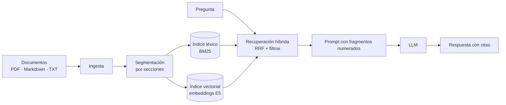

# Fundamenta

[](https://github.com/Andres-DLT/fundamenta-rag/actions/workflows/ci.yml)

[](LICENSE)

Un motor RAG (*Retrieval-Augmented Generation*) escrito desde cero en Python, sin
frameworks. Le das una carpeta de documentos (PDF, Markdown o texto) y responde
preguntas sobre ellos citando de dónde sale cada dato. Si la respuesta no está en los
documentos, lo dice en vez de inventarla.

Lo construí por partes, y cada parte tiene su módulo en `modulos/` con una explicación,
un cuaderno que se puede ejecutar y sus pruebas, para poder seguir cómo funciona cada
pieza.


## Qué hace

- Busca combinando BM25 (palabras exactas) con embeddings multilingües, así encuentra
  el fragmento correcto aunque la pregunta use otras palabras.
- Cada afirmación de la respuesta lleva una cita al documento, sección o página.
- Si no encuentra nada que responda la pregunta, se abstiene.
- Funciona con Claude, Gemini, OpenAI, cualquier API compatible con la de OpenAI,
  modelos locales con Ollama, o sin LLM (modo extractivo: solo muestra los fragmentos).
- Los embeddings se calculan en local.
- Se pueden filtrar documentos por metadatos, para que cada usuario vea solo lo que le
  toca.
- El núcleo solo depende de NumPy y pypdf, y el servidor web usa la librería estándar.

## Resultados

Lo probé con un caso de ejemplo: la documentación de NovaTech, una empresa ficticia, y
27 preguntas con respuesta. En 12 de ellas la pregunta usa palabras distintas a las de
los documentos, que es justo donde la búsqueda léxica sola se queda corta.

| Configuración | Fragmento correcto entre los 4 primeros | Preguntas directas | Preguntas parafraseadas |
|---|---:|---:|---:|
| Solo BM25 | 78 % | 100 % | 50 % |
| Híbrida con modelo multilingüe (por defecto) | 93 % | 100 % | 83 % |
| Híbrida con el modelo cuantizado (servidores de 512 MB) | 93 % | 100 % | 83 % |

El detalle y el análisis de errores están en el [módulo 09](modulos/09-evaluacion/README.md).
Son pocas preguntas sobre una colección pequeña, así que hay que tomarlo como
referencia y no como garantía.

## Probarlo

Necesitas Python 3.11 o superior.

```bash
git clone https://github.com/Andres-DLT/fundamenta-rag.git
cd fundamenta-rag
python -m venv .venv
source .venv/bin/activate          # en Windows: .venv\Scripts\activate
pip install -e ".[semantic]"
fundamenta serve --embedder semantic
```

Abre http://127.0.0.1:8000. Sin configurar nada responde en modo extractivo, mostrando
los fragmentos con su referencia. Para que un LLM redacte la respuesta:

```bash
pip install -e ".[claude]"
export ANTHROPIC_API_KEY=...       # en Windows: set ANTHROPIC_API_KEY=...
fundamenta serve --embedder semantic --llm claude
```

O con un modelo local en [Ollama](https://ollama.com):

```bash
ollama pull qwen2.5:7b
fundamenta serve --embedder semantic --llm ollama:qwen2.5:7b
```

Para usar tus propios documentos, pásale la carpeta con `--data`.

### Desde la terminal

| Comando | Qué hace |
|---|---|
| `fundamenta ask "pregunta"` | Responde una pregunta con sus fuentes |
| `fundamenta search "consulta"` | Muestra los fragmentos recuperados y su puntuación |
| `fundamenta serve` | Arranca la web y la API |
| `fundamenta eval` | Evalúa la recuperación (y las respuestas, con `--answers`) |

### Como librería

```python
from fundamenta import ClaudeLLM, PipelineConfig, RAGPipeline, SentenceTransformerEmbedder

pipeline = RAGPipeline.from_directory(
    "ruta/a/documentos",
    embedder=SentenceTransformerEmbedder(),
    llm=ClaudeLLM(),
    config=PipelineConfig(organization="Mi empresa"),
)

answer = pipeline.ask("¿Cuál es el procedimiento para solicitar vacaciones?")
print(answer.text)
for source in answer.sources:
    print(f"[{source.number}] {source.label}")
```

## Despliegue

Hay tres formas, todas con contraseña y un límite de preguntas por cliente:

- Una versión web gratis: la búsqueda corre en el navegador y la respuesta la redacta
  un LLM desde una función sin servidor (GitHub Pages + Vercel).
- Un servidor ligero en el plan gratuito de Render (`render.yaml`), con el modelo de
  embeddings cuantizado.
- Una imagen Docker para cualquier plataforma de contenedores o Hugging Face Spaces.

Los pasos están en [docs/despliegue.md](docs/despliegue.md).

## Cómo está hecho



| Pieza | Módulo | Código |
|---|---|---|
| Ingesta de documentos | 01 | [`loaders.py`](fundamenta/loaders.py) |
| Segmentación | 02 | [`chunking.py`](fundamenta/chunking.py) |
| Búsqueda léxica | 03 | [`text.py`](fundamenta/text.py), [`bm25.py`](fundamenta/bm25.py) |
| Embeddings | 04 | [`embeddings.py`](fundamenta/embeddings.py) |
| Almacén vectorial | 05 | [`vector_store.py`](fundamenta/vector_store.py) |
| Recuperación híbrida | 06 | [`retriever.py`](fundamenta/retriever.py) |
| Generación con citas | 07 | [`generation.py`](fundamenta/generation.py), [`llm.py`](fundamenta/llm.py) |
| Pipeline, CLI y web | 08 | [`pipeline.py`](fundamenta/pipeline.py), [`cli.py`](fundamenta/cli.py), [`server.py`](fundamenta/server.py) |
| Versión web sin servidor | | [`web.py`](fundamenta/web.py), [`engine.js`](web/engine.js), [`api/answer.py`](api/answer.py) |
| Evaluación | 09 | [`evaluation.py`](fundamenta/evaluation.py) |
| Reescritura de consultas | 10 | [`query.py`](fundamenta/query.py) |

## Módulos

- [00 · Introducción](modulos/00-introduccion/README.md): qué es RAG y cuándo conviene usarlo
- [01 · Ingesta de documentos](modulos/01-ingesta/README.md): leer formatos y metadatos
- [02 · Segmentación](modulos/02-segmentacion/README.md): partir en fragmentos sin romper la estructura
- [03 · Búsqueda léxica](modulos/03-busqueda-lexica/README.md): tokenización para español y BM25
- [04 · Embeddings](modulos/04-embeddings/README.md): LSA y un modelo neuronal multilingüe
- [05 · Almacén vectorial](modulos/05-almacen-vectorial/README.md): similitud, filtros y persistencia
- [06 · Recuperación híbrida](modulos/06-recuperacion-hibrida/README.md): Reciprocal Rank Fusion y MMR
- [07 · Generación con citas](modulos/07-generacion/README.md): prompt, proveedores y citas
- [08 · Pipeline y demo](modulos/08-pipeline-y-demo/README.md): API, CLI y web
- [09 · Evaluación](modulos/09-evaluacion/README.md): métricas y resultados
- [10 · Mejoras](modulos/10-mejoras/README.md): ajustes medidos y reescritura de consultas
- [11 · Producción](modulos/11-produccion/README.md): escalado, seguridad, operación y costes

## Pruebas

Hay 115 pruebas que cubren todas las piezas, el servidor web y la función de
generación. El CI de GitHub Actions pasa ruff, corre las pruebas en Python 3.11, 3.12 y
3.13 y ejecuta todos los cuadernos con el modelo de embeddings real.

```bash
pip install -e ".[all]"
ruff check . && pytest && pytest --nbmake modulos/
```

## Licencia

[MIT](LICENSE). NovaTech y sus documentos son inventados; solo están como caso de
ejemplo.
