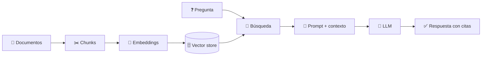

# 🧠 Build a RAG from Scratch

[](https://github.com/Andres-DLT/build-a-rag-from-scratch/actions/workflows/ci.yml)

[](LICENSE)

**Aprende a construir un sistema RAG desde cero, pieza a pieza y sin frameworks.**

RAG (*Retrieval-Augmented Generation*) es la técnica con la que las empresas consiguen
que la IA responda preguntas usando **sus propios datos**: manuales internos,
documentación, tickets de soporte... En este curso no vas a usar LangChain ni
LlamaIndex. Vas a escribir cada pieza tú mismo para entender qué ocurre por dentro.



## 🏢 El caso práctico: NovaTech

Durante todo el curso trabajamos con **NovaTech**, una empresa de software ficticia.
Su carpeta [`data/novatech/`](data/novatech/) contiene un manual del empleado, una
política de gastos, un catálogo de productos, unas FAQ de IT y un PDF de beneficios.

Al terminar, tu sistema podrá responder preguntas como estas, citando la fuente:

> **¿Cuántos días de vacaciones tengo?**
> Tienes 23 días laborables al año, más el 24 y el 31 de diciembre.
> *Fuente: manual-del-empleado.md*

> **¿Cuánto me pagan de dieta si viajo a Lisboa?**
> 60 € al día (tarifa para el resto de Europa).
> *Fuente: politica-de-gastos-y-viajes.md*

## 📚 Temario

| # | Capítulo | Lo que construyes | Estado |
|---|----------|-------------------|--------|
| 00 | [¿Qué es RAG y por qué existe?](chapters/00-que-es-rag/) | Un RAG de juguete en 30 líneas | ✅ |
| 01 | [Cargar documentos](chapters/01-cargar-documentos/) | Loaders para `.txt`, `.md` y `.pdf` | ✅ |
| 02 | Chunking | Trocear documentos con solapamiento | 🚧 |
| 03 | Búsqueda léxica | TF-IDF y BM25 en Python puro | 🚧 |
| 04 | Embeddings | Similitud coseno y búsqueda semántica | 🚧 |
| 05 | Vector store | Índice vectorial con NumPy y persistencia | 🚧 |
| 06 | Retrieval | Búsqueda híbrida y top-k | 🚧 |
| 07 | Generación | Prompt con contexto, citas y "no lo sé" | 🚧 |
| 08 | Pipeline completo | CLI `rag ask "..."` | 🚧 |
| 09 | Evaluación | recall@k, MRR y LLM-as-judge | 🚧 |
| 10 | Mejoras | Reranking y reescritura de consultas | 🚧 |
| 11 | Hacia producción | Bases de datos vectoriales y frameworks | 🚧 |

Cada capítulo incluye:

- 📖 Un `README.md` con la explicación.
- 📓 Un `notebook.ipynb` para experimentar paso a paso.
- 🧩 El código que se suma al paquete [`rag/`](rag/), con sus tests.

## 🚀 Empezar

Necesitas **Python 3.11 o superior**.

```bash
git clone https://github.com/Andres-DLT/build-a-rag-from-scratch.git
cd build-a-rag-from-scratch

python -m venv .venv
source .venv/bin/activate        # En Windows: .venv\Scripts\activate

pip install -e ".[dev,notebooks]"
```

Comprueba que todo funciona y abre los notebooks:

```bash
pytest
jupyter lab
```

Empieza por el [Capítulo 00](chapters/00-que-es-rag/).

## 🗂️ Estructura del repositorio

```
build-a-rag-from-scratch/
├── chapters/          # Una carpeta por capítulo: README.md + notebook.ipynb
├── rag/               # El sistema RAG que construyes a lo largo del curso
├── data/novatech/     # Documentos de la empresa ficticia
├── tests/             # Tests de cada pieza del sistema
└── pyproject.toml
```

## 🧭 Filosofía del curso

- **Desde cero.** Sin frameworks de RAG: si algo se puede escribir en 30 líneas, lo escribimos.
- **Dependencias mínimas.** Cada capítulo añade solo lo que necesita.
- **Siempre ejecutable.** Cada capítulo funciona por sí solo y la CI ejecuta todos los
  tests y notebooks.
- **Medir, no adivinar.** Antes de "mejorar" algo, lo evaluamos (capítulo 09).

## 🤝 Contribuir

¿Encontraste un error o tienes una idea? Abre un
[issue](https://github.com/Andres-DLT/build-a-rag-from-scratch/issues). Antes de
enviar un pull request, comprueba que pasan el linter y los tests:

```bash
ruff check . && ruff format --check .
pytest
pytest --nbmake chapters/
```

## 📄 Licencia

[MIT](LICENSE). NovaTech y todos sus documentos son ficticios; cualquier parecido con
una empresa real es pura coincidencia.
