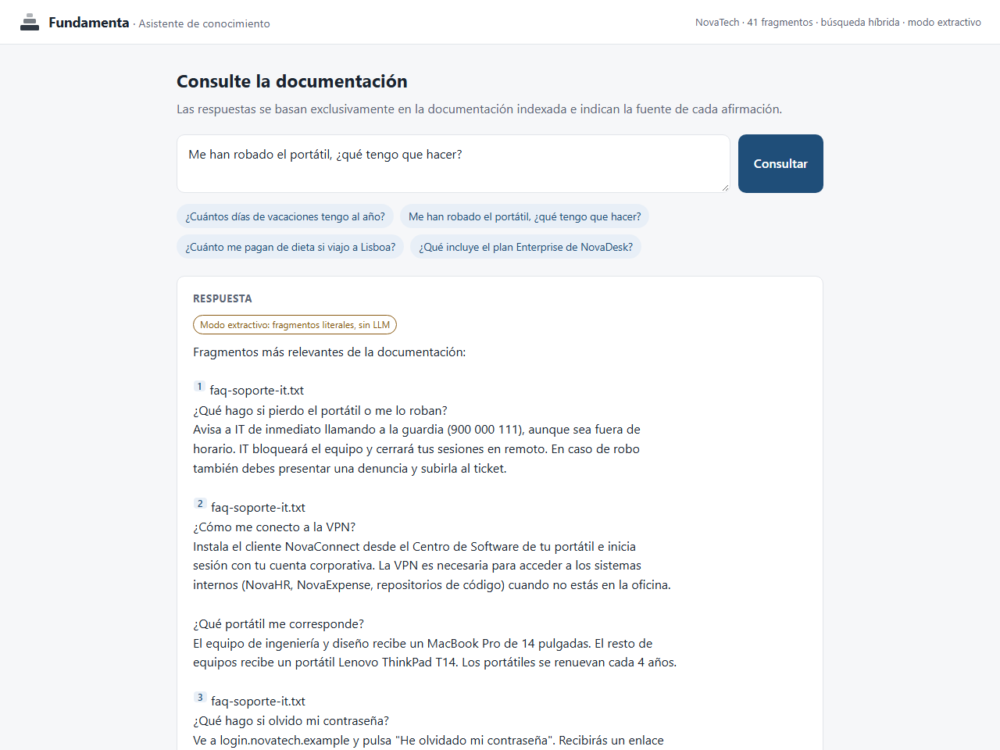
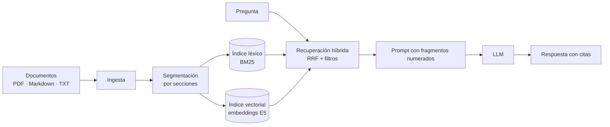

# Fundamenta

[](https://github.com/Andres-DLT/fundamenta-rag/actions/workflows/ci.yml)

[](LICENSE)

**Respuestas fundamentadas en la documentación de su organización, con citas verificables.**

Fundamenta es un motor RAG (*Retrieval-Augmented Generation*) construido desde cero en
Python. Permite que un modelo de lenguaje responda preguntas sobre manuales, políticas,
catálogos o bases de conocimiento internas, indicando la fuente exacta de cada
afirmación y absteniéndose cuando la documentación no contiene la respuesta.

El proyecto incluye un **programa técnico de doce módulos** que documenta, paso a paso
y con código ejecutable, cada componente del sistema.



## Capacidades

| | |
|---|---|
| **Respuestas con citas** | Cada afirmación remite al documento, sección o página de origen. |
| **Abstención controlada** | Si la documentación no contiene la respuesta, el sistema lo indica en lugar de inventar. |
| **Búsqueda híbrida** | Combina búsqueda léxica (BM25) y semántica multilingüe para entender preguntas formuladas con otras palabras. |
| **Datos bajo control** | Los embeddings se calculan en local y la generación puede realizarse con modelos en infraestructura propia. |
| **Independencia del proveedor** | Claude (Anthropic), cualquier modelo abierto vía Ollama o modo extractivo sin LLM. |
| **Control de acceso** | Filtros por metadatos para que cada usuario consulte solo lo que está autorizado a ver. |
| **Calidad medible** | Evaluación integrada con métricas de recuperación y de respuesta. |
| **Dependencias mínimas** | Núcleo basado en NumPy y pypdf; servidor web con la librería estándar. |

## Resultados

Evaluación sobre el caso de estudio incluido (documentación de NovaTech, empresa
ficticia): 27 preguntas con respuesta, de las que 12 están formuladas con un
vocabulario distinto al de los documentos.

| Configuración | Fragmento correcto entre los 4 primeros | Preguntas directas | Preguntas parafraseadas |
|---|---:|---:|---:|
| Búsqueda léxica (BM25) | 78 % | 100 % | 50 % |
| **Búsqueda híbrida con modelo multilingüe** (por defecto) | **93 %** | **100 %** | **83 %** |
| Búsqueda híbrida con el modelo cuantizado (servidores de 512 MB) | 93 % | 100 % | 83 % |

La metodología, el detalle por configuración y el análisis de errores se describen en
el [módulo 09](modulos/09-evaluacion/README.md). Los resultados corresponden a una
colección pequeña y deben validarse con la documentación y las preguntas de cada
organización.

## Inicio rápido

Requisitos: Python 3.11 o superior.

```bash
git clone https://github.com/Andres-DLT/fundamenta-rag.git
cd fundamenta-rag
python -m venv .venv
source .venv/bin/activate          # Windows: .venv\Scripts\activate
pip install -e ".[semantic]"
```

Arranque la demostración web sobre el caso de estudio y abra http://127.0.0.1:8000:

```bash
fundamenta serve --embedder semantic
```

Sin más configuración, el sistema responde en **modo extractivo**, mostrando los
fragmentos relevantes con sus referencias. Para respuestas redactadas por un modelo de
lenguaje:

```bash
pip install -e ".[claude]"
export ANTHROPIC_API_KEY=...       # Windows: set ANTHROPIC_API_KEY=...
fundamenta serve --embedder semantic --llm claude
```

O bien, con un modelo abierto en local mediante [Ollama](https://ollama.com):

```bash
ollama pull qwen2.5:7b
fundamenta serve --embedder semantic --llm ollama:qwen2.5:7b
```

Para usar su propia documentación, indique la carpeta con `--data` (formatos admitidos:
PDF, Markdown y texto).

## Despliegue

Fundamenta incluye un `Dockerfile` listo para producción, una configuración para
desplegar en Render con un clic (`render.yaml`, compatible con su plan gratuito) y un
script de despliegue en Hugging Face Spaces. La aplicación admite contraseña de acceso y
límite de preguntas por cliente. Consulte la [guía de despliegue](docs/despliegue.md).

## Uso como librería

```python
from fundamenta import ClaudeLLM, PipelineConfig, RAGPipeline, SentenceTransformerEmbedder

pipeline = RAGPipeline.from_directory(
    "ruta/a/documentos",
    embedder=SentenceTransformerEmbedder(),
    llm=ClaudeLLM(),
    config=PipelineConfig(organization="Su organización"),
)

answer = pipeline.ask("¿Cuál es el procedimiento para solicitar vacaciones?")
print(answer.text)
for source in answer.sources:
    print(f"[{source.number}] {source.label}")
```

## Línea de comandos

| Comando | Función |
|---|---|
| `fundamenta ask "pregunta"` | Responde a una pregunta con sus fuentes |
| `fundamenta search "consulta"` | Muestra los fragmentos recuperados y su puntuación |
| `fundamenta serve` | Arranca la aplicación web y la API |
| `fundamenta eval` | Evalúa la calidad de la recuperación (y de las respuestas con `--answers`) |

## Arquitectura



| Componente | Módulo | Código |
|---|---|---|
| Ingesta de documentos | 01 | [`loaders.py`](fundamenta/loaders.py) |
| Segmentación | 02 | [`chunking.py`](fundamenta/chunking.py) |
| Búsqueda léxica | 03 | [`text.py`](fundamenta/text.py), [`bm25.py`](fundamenta/bm25.py) |
| Embeddings | 04 | [`embeddings.py`](fundamenta/embeddings.py) |
| Almacén vectorial | 05 | [`vector_store.py`](fundamenta/vector_store.py) |
| Recuperación híbrida | 06 | [`retriever.py`](fundamenta/retriever.py) |
| Generación con citas | 07 | [`generation.py`](fundamenta/generation.py), [`llm.py`](fundamenta/llm.py) |
| Pipeline, CLI y web | 08 | [`pipeline.py`](fundamenta/pipeline.py), [`cli.py`](fundamenta/cli.py), [`server.py`](fundamenta/server.py) |
| Evaluación | 09 | [`evaluation.py`](fundamenta/evaluation.py) |
| Reescritura de consultas | 10 | [`query.py`](fundamenta/query.py) |

## Programa técnico

| Módulo | Contenido |
|---|---|
| [00 · Introducción](modulos/00-introduccion/README.md) | Qué es RAG y cuándo utilizarlo |
| [01 · Ingesta de documentos](modulos/01-ingesta/README.md) | Lectura de formatos y metadatos |
| [02 · Segmentación](modulos/02-segmentacion/README.md) | División en fragmentos respetando la estructura |
| [03 · Búsqueda léxica](modulos/03-busqueda-lexica/README.md) | Tokenización para español y BM25 |
| [04 · Embeddings](modulos/04-embeddings/README.md) | LSA y modelo neuronal multilingüe |
| [05 · Almacén vectorial](modulos/05-almacen-vectorial/README.md) | Búsqueda por similitud, filtros y persistencia |
| [06 · Recuperación híbrida](modulos/06-recuperacion-hibrida/README.md) | Reciprocal Rank Fusion y MMR |
| [07 · Generación con citas](modulos/07-generacion/README.md) | Prompt, proveedores y citas |
| [08 · Pipeline y demostración](modulos/08-pipeline-y-demo/README.md) | API, CLI y aplicación web |
| [09 · Evaluación](modulos/09-evaluacion/README.md) | Métricas y resultados |
| [10 · Mejoras de calidad](modulos/10-mejoras/README.md) | Ajustes medidos y reescritura de consultas |
| [11 · Puesta en producción](modulos/11-produccion/README.md) | Escalado, seguridad, operación y costes |

Cada módulo incluye un documento explicativo, un cuaderno ejecutable y pruebas
automatizadas.

## Estructura del repositorio

```text
fundamenta-rag/
├── fundamenta/              Paquete de Python (motor RAG, CLI y servidor web)
├── modulos/                 Programa técnico: un directorio por módulo
├── data/novatech/           Caso de estudio: documentación de una empresa ficticia
├── evaluacion/              Conjunto de preguntas de referencia
├── tests/                   Pruebas automatizadas
├── docs/                    Documentación para clientes y guía de despliegue
├── scripts/                 Script de despliegue en Hugging Face Spaces
└── Dockerfile               Imagen de producción
```

## Calidad

- 85 pruebas automatizadas que cubren todos los componentes, incluidos el servidor web,
  su protección de acceso y la integración con los proveedores de modelos.
- Integración continua en GitHub Actions: análisis estático, pruebas en Python 3.11,
  3.12 y 3.13, y ejecución de todos los cuadernos con el modelo de embeddings real.

```bash
pip install -e ".[all]"
ruff check . && pytest && pytest --nbmake modulos/
```

## Documentación adicional

- [Resumen ejecutivo](docs/resumen-ejecutivo.md): propuesta de valor, casos de uso y
  modalidades de implantación.
- [Despliegue](docs/despliegue.md): Docker, Hugging Face Spaces y configuración.
- [Puesta en producción](modulos/11-produccion/README.md): arquitectura de referencia,
  seguridad y costes.

## Autor

**Andrés de la Torre Flores** · [github.com/Andres-DLT](https://github.com/Andres-DLT)

## Licencia

[MIT](LICENSE). NovaTech y toda su documentación son ficticios y se incluyen
exclusivamente como caso de estudio.
