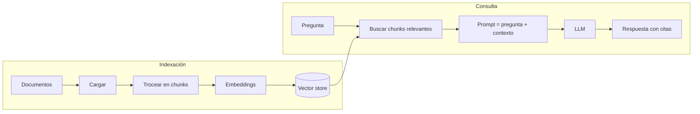

# Capítulo 00: ¿Qué es RAG y por qué existe?

> **En este capítulo** entenderás qué problema resuelve RAG, cuáles son sus piezas
> y construirás un "RAG de juguete" en unas 30 líneas de Python, sin instalar nada
> y sin API keys.

📓 Notebook: [`notebook.ipynb`](notebook.ipynb)

---

## El problema: un LLM no conoce tus datos

Un modelo de lenguaje (LLM) como Claude o GPT aprende de una enorme cantidad de texto
público hasta una fecha concreta. Eso tiene tres consecuencias:

1. **No conoce tus documentos privados.** Nunca ha visto el manual interno de tu
   empresa, tus contratos ni tu base de conocimiento.
2. **Su conocimiento tiene fecha de caducidad.** Lo que cambió ayer no lo sabe.
3. **Cuando no sabe algo, a veces se lo inventa.** A esto se le llama *alucinación*.

Imagina que una persona de NovaTech (la empresa ficticia que usamos en el curso)
pregunta:

> ¿Cuántos días de vacaciones tengo al año?

Un LLM "a secas" no tiene forma de saberlo. Puede contestar con algo genérico
("depende de tu empresa") o, peor, inventar una cifra que suena razonable. La
respuesta correcta (**23 días laborables**) está en un documento interno que el
modelo nunca ha leído.

## La idea: un examen a libro abierto

**RAG** son las siglas de *Retrieval-Augmented Generation*, es decir, generación
aumentada con recuperación. La idea es sencilla:

> Antes de pedirle al modelo que responda, **buscamos** los fragmentos de nuestros
> documentos que tienen que ver con la pregunta y se los **pegamos en el prompt**.

Es como pasar de un examen de memoria a un examen a libro abierto: el modelo ya no
tiene que "recordar" la respuesta, solo leer el contexto que le damos y redactarla.

Las tres letras describen los tres pasos:

| Paso | Qué hace |
|------|----------|
| **R**etrieval (recuperación) | Busca los fragmentos más relevantes para la pregunta. |
| **A**ugmentation (aumento) | Construye un prompt con la pregunta y esos fragmentos. |
| **G**eneration (generación) | El LLM redacta la respuesta usando ese contexto. |

## Las dos fases de un sistema RAG

Un sistema RAG trabaja en dos momentos distintos.

**1. Indexación (una vez, o cada vez que cambian los documentos).** Preparamos los
documentos para que sea rápido buscar en ellos.

**2. Consulta (cada vez que alguien pregunta).** Buscamos, construimos el prompt y
generamos la respuesta.

Cada caja del diagrama es un capítulo de este curso.

## ¿Por qué no simplemente...?

**...entrenar el modelo con mis documentos (fine-tuning)?** El fine-tuning sirve para
enseñar un *estilo* o un *formato*, pero es una mala forma de enseñar *hechos*: es
caro, hay que repetirlo cada vez que cambia un documento y el modelo sigue sin poder
decirte de dónde saca la información.

**...meter todos los documentos en el prompt?** Con pocos documentos, ¡es una opción
válida! Pero cuando tienes miles de páginas no caben, cada pregunta cuesta mucho más
(pagas por cada token del prompt), las respuestas tardan más y los modelos se
"pierden" con más facilidad en contextos enormes.

| | RAG | Fine-tuning | Todo en el prompt |
|---|---|---|---|
| Actualizar datos | Reindexar (minutos) | Reentrenar (horas o días) | Inmediato |
| Escala | Millones de documentos | Limitada | Lo que quepa en el contexto |
| Citar fuentes | ✅ | ❌ | Difícil |
| Coste por pregunta | Bajo | Bajo | Alto |
| Controlar permisos por usuario | ✅ Filtrando la búsqueda | ❌ | ⚠️ |

Por eso RAG es la forma más habitual en la que las empresas conectan la IA con sus
propios datos: asistentes internos, chatbots de soporte, buscadores de documentación...

## Qué vamos a construir

Al final del curso tendrás un paquete `rag/` escrito por ti, capítulo a capítulo:

| Capítulo | Pieza | Archivo |
|----------|-------|---------|
| 01 | Cargar documentos | `rag/loaders.py` |
| 02 | Trocear en chunks | `rag/chunking.py` |
| 03 | Búsqueda por palabras (BM25) | `rag/bm25.py` |
| 04 | Embeddings | `rag/embeddings.py` |
| 05 | Vector store | `rag/vector_store.py` |
| 06 | Recuperación híbrida | `rag/retriever.py` |
| 07 | Generación con un LLM | `rag/llm.py` |
| 08 | Pipeline completo y CLI | `rag/pipeline.py` |

## Pruébalo: un RAG de juguete

Abre el [notebook](notebook.ipynb). En unas 30 líneas vas a:

1. Definir una mini base de conocimiento con 5 frases sobre NovaTech.
2. **Recuperar** las frases que comparten palabras con la pregunta.
3. **Aumentar** el prompt con esas frases.
4. Ver el prompt final que recibiría el LLM.

También verás sus límites. Por ejemplo, si preguntas *"¿Qué pasa si me roban el
ordenador?"*, no encuentra el documento que habla de *"robo del portátil"* porque
las palabras no coinciden exactamente. Resolver ese tipo de problemas es justo lo
que haremos en los siguientes capítulos.

## Glosario

- **LLM** (*Large Language Model*): modelo que genera texto, como Claude.
- **Token**: la unidad en la que el LLM lee el texto, normalmente un trozo de
  palabra. En español, una palabra suele ocupar uno o dos tokens.
- **Prompt**: el texto que le enviamos al LLM.
- **Contexto**: los fragmentos de documentos que añadimos al prompt.
- **Chunk**: un trozo de un documento, del tamaño adecuado para buscar y para el prompt.
- **Embedding**: un vector de números que representa el significado de un texto.
- **Vector store**: la "base de datos" donde guardamos los embeddings para buscar en ellos.
- **Top-k**: los *k* resultados más relevantes de una búsqueda.
- **Alucinación**: cuando el modelo afirma algo falso con total seguridad.

---

➡️ **Siguiente:** [Capítulo 01: Cargar documentos](../01-cargar-documentos/README.md)
