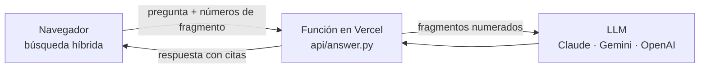

# Despliegue

Fundamenta puede desplegarse de tres formas, con la misma interfaz y la misma calidad
de búsqueda:

| | Versión web | Configuración ligera (`onnx`) | Imagen Docker completa (`semantic`) |
|---|---|---|---|
| Dónde se busca | En el navegador del visitante | En el servidor | En el servidor |
| Generación con LLM | Función sin servidor (Vercel) | En el servidor | En el servidor |
| Modelo de embeddings | E5 cuantizado, con transformers.js | E5 cuantizado, con ONNX Runtime | E5 original, con PyTorch |
| Infraestructura | Páginas estáticas + función | Servidor de 512 MB | Servidor de 2 GB |
| Acierto en la evaluación | 93 % (MRR 0,83) | 93 % (MRR 0,80) | 93 % (MRR 0,82) |
| Coste de alojamiento | Gratuito | Gratuito (Render) | Desde unos dólares al mes |
| Uso recomendado | Demostraciones | Demostraciones | Producción y desarrollo |

En ningún caso se necesita GPU.

## Configuración

| Variable | Descripción | Por defecto |
|---|---|---|
| `FUNDAMENTA_PASSWORD` | Contraseña de acceso a la interfaz y a la API. **Recomendada** en cualquier despliegue público. | sin contraseña |
| `FUNDAMENTA_LLM` | `none` (modo extractivo), `claude[:<modelo>]`, `gemini[:<modelo>]`, `openai:<modelo>`, `ollama:<modelo>` o `compatible:<modelo>` | `none` |
| `ANTHROPIC_API_KEY` | Clave de la API de Anthropic, necesaria con `FUNDAMENTA_LLM=claude` | — |
| `GEMINI_API_KEY` / `OPENAI_API_KEY` | Clave de Google Gemini u OpenAI, con `gemini` u `openai` | — |
| `FUNDAMENTA_LLM_BASE_URL` / `FUNDAMENTA_LLM_API_KEY` | Dirección y clave de otro proveedor compatible con la API de OpenAI (OpenRouter, Groq…), con `compatible:<modelo>` | — |
| `OLLAMA_HOST` | Dirección del servidor de Ollama, con `FUNDAMENTA_LLM=ollama:<modelo>` | `http://localhost:11434` |
| `FUNDAMENTA_RATE_LIMIT` | Preguntas por minuto y cliente | 30 |
| `FUNDAMENTA_DATA` | Carpeta de documentos dentro del contenedor | `data/novatech` |
| `FUNDAMENTA_EMBEDDER` | `semantic` (modelo E5), `onnx` (E5 cuantizado, sin PyTorch) o `lsa` | `semantic` |
| `PORT` | Puerto HTTP | 7860 |

Las claves y contraseñas deben configurarse como **secretos** de la plataforma, nunca
en el código ni en la imagen.

## Opción 1: versión web (GitHub Pages + Vercel, gratuita)

La búsqueda se ejecuta en el navegador de cada visitante: la página descarga el índice
de la documentación y el modelo de embeddings (unos 120 MB la primera vez; después
queda en la caché del navegador). Para redactar las respuestas, la página llama a una
función sin servidor que usa el mismo `AnswerGenerator` que el servidor:



El navegador solo envía la pregunta y los números de los fragmentos: la función los
reconstruye a partir de los mismos documentos, de modo que no puede usarse para enviar
textos arbitrarios al modelo. La clave de Anthropic permanece en Vercel y la función
exige la contraseña de acceso.

**1. Página web (GitHub Pages).** El flujo `.github/workflows/pages.yml` genera la web
con `scripts/build_web.py` y la publica en cada cambio de la rama principal, en
`https://<usuario>.github.io/<repositorio>/`. Solo hay que activar GitHub Pages en
*Settings > Pages > Source: GitHub Actions*. Sin función de generación, la página
responde en modo extractivo.

**2. Clave del modelo de lenguaje.** Cualquiera de estas opciones:

- **Claude**: en [platform.claude.com](https://platform.claude.com), cree una clave
  (*API Keys*), recargue saldo (*Billing*) y fije un límite de gasto mensual (*Limits*).
- **Google Gemini**: en [aistudio.google.com/apikey](https://aistudio.google.com/apikey),
  cree una clave. El plan gratuito es suficiente para una demostración, pero Google
  puede utilizar su contenido para mejorar sus productos: úselo solo con documentación
  no confidencial.

**3. Función de generación (Vercel).**

1. Cree una cuenta en [vercel.com](https://vercel.com) con su cuenta de GitHub.
2. *Add New > Project*, importe el repositorio y, en *Environment Variables*, añada:
   - `FUNDAMENTA_PASSWORD`: la contraseña que compartirá con las personas invitadas.
   - `ANTHROPIC_API_KEY` o `GEMINI_API_KEY`: la clave del paso anterior. La función
     elige el proveedor según la clave configurada.
   - `FUNDAMENTA_ALLOWED_ORIGIN` (recomendada): `https://<usuario>.github.io`.
3. Pulse *Deploy*. La función queda en `https://<proyecto>.vercel.app/api/answer`.

**4. Conexión.** En GitHub, *Settings > Secrets and variables > Actions > Variables*,
cree la variable `FUNDAMENTA_GENERATION_URL` con la dirección de la función y vuelva a
ejecutar el flujo *Web* (*Actions > Web > Run workflow*). La página pedirá la
contraseña y las respuestas pasarán a redactarse con el modelo de lenguaje.

Variables opcionales de la función: `FUNDAMENTA_LLM` (por defecto, el proveedor de la
clave configurada; por ejemplo `gemini:<modelo>` para usar otro modelo) y
`FUNDAMENTA_RATE_LIMIT` (preguntas por minuto y visitante, 20 por defecto).

Para generar la web en local:

```bash
pip install -e ".[onnx]"
python scripts/build_web.py --out site
python -m http.server --directory site
```

## Opción 2: Render (plan gratuito)

El repositorio incluye `render.yaml`, que describe el servicio completo: instalación,
descarga del modelo, arranque y comprobación de salud. Render lo publica en una
dirección estable del tipo `https://fundamenta-xxxx.onrender.com`.

1. Cree una cuenta en [render.com](https://render.com) con su cuenta de GitHub.
2. En el panel, elija *New > Blueprint* y seleccione el repositorio `fundamenta-rag`.
3. Render mostrará el servicio `fundamenta` y le pedirá el valor de
   `FUNDAMENTA_PASSWORD`: escriba la contraseña que compartirá con las personas
   invitadas.
4. Pulse *Deploy Blueprint*. La primera construcción tarda unos cinco minutos; cuando el
   estado pase a *Live*, abra la dirección del servicio. El navegador solicitará un
   usuario —cualquiera es válido— y la contraseña configurada.

Cada vez que se actualice la rama principal del repositorio, Render vuelve a desplegar
automáticamente. Para respuestas generadas con Claude, añada en *Environment* las
variables `FUNDAMENTA_LLM=claude` y `ANTHROPIC_API_KEY`.

Los servicios gratuitos de Render se suspenden tras 15 minutos sin uso y se reactivan
con la siguiente visita, que tarda aproximadamente un minuto. Para una demostración
importante, conviene abrir la aplicación unos minutos antes.

## Opción 3: Hugging Face Spaces

Ejecuta la imagen Docker completa con 2 vCPU y 16 GB de memoria, y publica la aplicación
en una dirección estable del tipo `https://<usuario>-fundamenta.hf.space`. Alojar
aplicaciones Docker en Hugging Face requiere una suscripción PRO.

1. Cree una cuenta en [huggingface.co](https://huggingface.co) y un token de acceso
   con permiso de escritura (*Settings > Access Tokens*).
2. Inicie sesión desde la terminal:

   ```bash
   pip install -e ".[deploy]"
   hf auth login
   ```

3. Despliegue:

   ```bash
   python scripts/deploy_huggingface.py --space <usuario>/fundamenta
   ```

   Para respuestas generadas con Claude, añada `--llm claude`.

4. En la página del Space, *Settings > Variables and secrets*, cree los secretos:
   - `FUNDAMENTA_PASSWORD`: la contraseña que compartirá con las personas invitadas.
   - `ANTHROPIC_API_KEY`: solo si utiliza `--llm claude`.

5. Espere a que el estado del Space pase a *Running* (la primera construcción tarda
   varios minutos) y abra la dirección de la aplicación. El navegador solicitará un
   usuario —cualquiera es válido— y la contraseña configurada.

## Opción 4: cualquier plataforma de contenedores

Railway, Google Cloud Run, Azure Container Apps o un servidor propio:

```bash
docker build -t fundamenta .
docker run -p 7860:7860 \
  -e FUNDAMENTA_PASSWORD=... \
  -e FUNDAMENTA_LLM=claude \
  -e ANTHROPIC_API_KEY=... \
  fundamenta
```

Elija una instancia de al menos 2 GB de memoria y configure las variables de la tabla
anterior como secretos de la plataforma.

## Documentación propia

Para desplegar con la documentación de otra organización, sustituya el contenido de
`data/` antes de construir la imagen, o monte un volumen y ajuste `FUNDAMENTA_DATA`:

```bash
docker run -p 7860:7860 -v /ruta/documentos:/datos -e FUNDAMENTA_DATA=/datos fundamenta
```

## Seguridad

- Active siempre `FUNDAMENTA_PASSWORD` en despliegues públicos: sin ella, cualquier
  persona con la dirección puede hacer preguntas y consumir el crédito del proveedor
  del modelo.
- El límite por cliente (`FUNDAMENTA_RATE_LIMIT`) acota el consumo, pero no sustituye a
  la contraseña.
- Con un proveedor externo (Claude, Gemini, OpenAI), los fragmentos recuperados se
  envían a ese proveedor. Si la documentación es confidencial, utilice un plan que no
  use los datos para entrenar, Ollama en la propia infraestructura o el modo
  extractivo.
- Para un despliegue corporativo, consulte los requisitos del
  [módulo 11](../modulos/11-produccion/README.md): autenticación con el proveedor de
  identidad, control de acceso por documento y registro de consultas.
