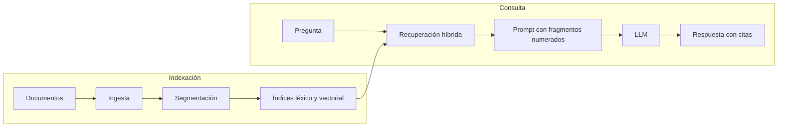

# Módulo 00 · Introducción a RAG

> Qué problema resuelve la generación aumentada con recuperación, cuáles son sus
> componentes y en qué se diferencia de otras alternativas.

**Material:** [cuaderno](notebook.ipynb)

---

## El problema: un modelo de lenguaje no conoce los datos de su organización

Un modelo de lenguaje (LLM) aprende de grandes volúmenes de texto público hasta una
fecha de corte. De ello se derivan tres limitaciones:

1. **No conoce la documentación privada**: manuales internos, contratos, procedimientos
   o bases de conocimiento de soporte.
2. **Su conocimiento tiene fecha de caducidad**: los cambios posteriores a su
   entrenamiento le son desconocidos.
3. **Puede generar respuestas verosímiles pero incorrectas** cuando carece de la
   información (las llamadas *alucinaciones*).

Ante la pregunta "¿cuántos días de vacaciones tengo?" de una persona empleada de
NovaTech —la empresa ficticia que se usa como caso de estudio—, un modelo sin acceso
a la documentación interna no puede conocer la respuesta correcta (23 días laborables).

## La solución: consultar antes de responder

**RAG** (*Retrieval-Augmented Generation*) incorpora un paso previo a la generación:
se buscan los fragmentos de la documentación relacionados con la pregunta y se
entregan al modelo junto con ella. El modelo deja de depender de lo que "recuerda" y
pasa a redactar a partir de las fuentes, como en un examen a libro abierto.

| Etapa | Función |
|---|---|
| **Recuperación** (*retrieval*) | Localiza los fragmentos más relevantes para la pregunta. |
| **Aumento** (*augmentation*) | Construye un prompt con la pregunta y esos fragmentos. |
| **Generación** (*generation*) | El modelo redacta la respuesta citando las fuentes. |

## Arquitectura

Un sistema RAG opera en dos fases:

- **Indexación**, cada vez que cambian los documentos: se cargan, se dividen en
  fragmentos y se construyen los índices de búsqueda.
- **Consulta**, en cada pregunta: se recuperan los fragmentos, se construye el prompt
  y se genera la respuesta.

## Alternativas y cuándo elegir RAG

| | RAG | Ajuste fino (*fine-tuning*) | Toda la documentación en el prompt |
|---|---|---|---|
| Actualización de contenidos | Reindexar (minutos) | Reentrenar (horas o días) | Inmediata |
| Volumen de documentación | Prácticamente ilimitado | Limitado | Limitado por el contexto |
| Citas a las fuentes | Sí | No | Difícil |
| Coste por consulta | Bajo | Bajo | Alto |
| Control de acceso por usuario | Sí, filtrando la búsqueda | No | Limitado |

El ajuste fino es adecuado para enseñar un estilo o un formato, no para incorporar
hechos que cambian. Incluir toda la documentación en el prompt es viable con
colecciones pequeñas, pero su coste y latencia crecen con cada consulta. RAG es la
opción habitual para asistentes internos, soporte al cliente y búsqueda documental.

## Contenido del cuaderno

El cuaderno implementa un sistema RAG mínimo en unas treinta líneas, sin dependencias
ni credenciales, y muestra su principal limitación: una búsqueda por coincidencia de
palabras no reconoce que "ordenador" y "portátil" se refieren a lo mismo. Los módulos
siguientes resuelven esta y otras limitaciones de forma progresiva.

## Glosario

- **LLM** (*Large Language Model*): modelo que genera texto a partir de instrucciones.
- **Token**: unidad mínima de texto que procesa un LLM, habitualmente un fragmento de
  palabra. Determina el coste y la capacidad de contexto.
- **Prompt**: texto que se envía al modelo.
- **Fragmento** (*chunk*): porción de un documento que se indexa y se recupera.
- **Embedding**: vector numérico que representa el significado de un texto.
- **Almacén vectorial**: estructura que permite buscar embeddings similares.
- **Top-k**: los *k* resultados más relevantes de una búsqueda.

---

[Índice del programa](../README.md) · [Módulo 01 · Ingesta de documentos →](../01-ingesta/README.md)
