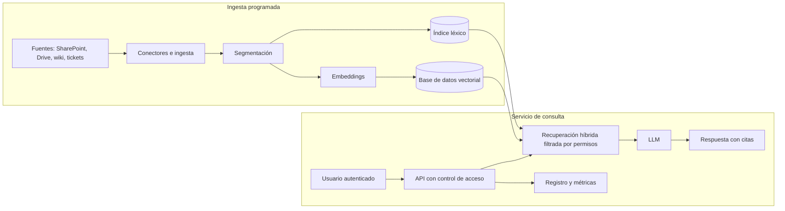

# Módulo 11 · Puesta en producción

> Requisitos y decisiones para llevar un sistema RAG de un entorno de demostración a
> un servicio corporativo: escalado, seguridad, operación, costes y relación con los
> frameworks del mercado.

---

## Arquitectura de referencia

La [guía de despliegue](../../docs/despliegue.md) describe cómo publicar la versión de
demostración con Docker o Hugging Face Spaces.

## Escalado

| Componente | Demostración (Fundamenta) | Producción |
|---|---|---|
| Índice vectorial | Matriz de NumPy en memoria | pgvector, Qdrant, Weaviate, OpenSearch, Elasticsearch |
| Índice léxico | BM25 en memoria | OpenSearch, Elasticsearch o búsqueda de texto de PostgreSQL |
| Embeddings | Modelo local en CPU | Servicio dedicado con GPU o API de embeddings |
| Ingesta | Carpeta local al arrancar | Conectores con actualización incremental programada |

Criterios de elección de la base de datos vectorial:

- **pgvector**: adecuada si la organización ya opera PostgreSQL; permite combinar
  filtros SQL, permisos y búsqueda vectorial en una misma consulta.
- **Qdrant o Weaviate**: especializadas, con filtrado eficiente y búsqueda híbrida.
- **OpenSearch o Elasticsearch**: recomendables si ya existe un buscador corporativo,
  porque integran BM25 y vectores en un mismo motor.

El código de Fundamenta separa estas responsabilidades (`VectorStore`, `BM25Index`,
`Embedder`), por lo que sustituir una implementación no afecta al resto del sistema.

## Seguridad y cumplimiento

1. **Control de acceso en la recuperación.** Cada fragmento hereda los permisos de su
   documento y la búsqueda se filtra por los del usuario (módulo 05). El modelo nunca
   debe recibir información que el usuario no pueda consultar.
2. **Autenticación** mediante el proveedor de identidad corporativo (SSO, OAuth 2.0 /
   OpenID Connect) y **HTTPS** en todas las comunicaciones.
3. **Protección de datos.** Clasificar qué documentos pueden enviarse a un proveedor
   externo. Para información sensible, utilizar modelos en infraestructura propia
   (`OllamaLLM`) o acuerdos de tratamiento de datos con el proveedor.
4. **Inyección de instrucciones.** Indexar solo fuentes de confianza, mantener las
   instrucciones del sistema separadas del contenido recuperado y revisar los
   documentos de origen externo.
5. **Trazabilidad.** Registrar pregunta, usuario, fragmentos recuperados, respuesta y
   versión del índice, respetando la normativa de protección de datos aplicable
   (RGPD en la Unión Europea).

## Operación

| Aspecto | Práctica recomendada |
|---|---|
| Actualización de documentos | Reindexación incremental por fecha de modificación o eventos |
| Calidad | Evaluación automática (módulo 09) en cada cambio y en producción con muestras periódicas |
| Retroalimentación | Valoración de cada respuesta por el usuario e incorporación de fallos al conjunto de evaluación |
| Monitorización | Latencia, tasa de abstención, errores del proveedor, coste por consulta |
| Disponibilidad | Modo extractivo como alternativa si el proveedor del modelo no responde |

## Costes

El coste por consulta lo determinan principalmente los tokens enviados al modelo. Con
*k* = 4 fragmentos de unos 125 tokens, más las instrucciones y la pregunta, cada
consulta envía del orden de 700 a 900 tokens de entrada y recibe entre 100 y 300 de
salida. Las palancas principales son:

- el número y tamaño de los fragmentos (módulo 10);
- la elección del modelo y su nivel de esfuerzo de razonamiento (módulo 07);
- el almacenamiento en caché de las instrucciones del sistema, que ofrecen los
  principales proveedores.

Los embeddings y la búsqueda tienen un coste marginal: se calculan una vez por
fragmento y la búsqueda se resuelve en milisegundos (módulo 05).

## Relación con los frameworks del mercado

LangChain, LlamaIndex y Haystack ofrecen componentes equivalentes a los de este
programa e integraciones con cientos de fuentes y bases de datos.

| | Implementación propia (Fundamenta) | Framework |
|---|---|---|
| Comprensión y control | Total | Limitados por las abstracciones |
| Dependencias | Mínimas | Numerosas, con cambios frecuentes de API |
| Integraciones disponibles | Las que se implementen | Muy amplias |
| Velocidad de prototipado | Media | Alta |

La práctica habitual en equipos maduros es combinar ambos enfoques: usar conectores de
un framework para la ingesta y mantener bajo control propio los componentes críticos
—recuperación, prompts y evaluación—, que son los que determinan la calidad.

## Lista de comprobación previa a producción

- [ ] Conjunto de evaluación con preguntas reales y resultados documentados
- [ ] Control de acceso aplicado en la recuperación
- [ ] Autenticación corporativa y HTTPS
- [ ] Política de datos aprobada para el proveedor del modelo
- [ ] Reindexación automática de las fuentes
- [ ] Registro de consultas y métricas de calidad, latencia y coste
- [ ] Mecanismo de valoración de respuestas por los usuarios
- [ ] Procedimiento de actuación ante respuestas incorrectas

---

[← Módulo 10 · Mejoras de calidad](../10-mejoras/README.md) · [Índice del programa](../README.md)
